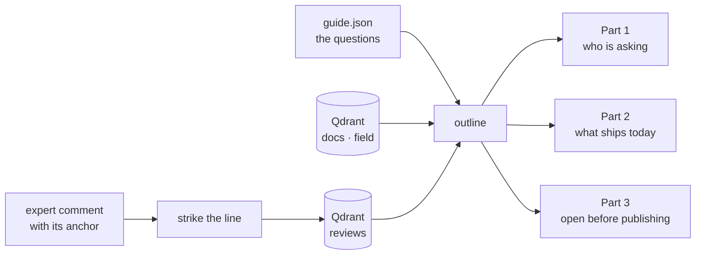

# field-guides

**Outline a deal-backed guide with shipped facts and open questions kept apart, and every expert objection attached to its sentence.**

"True for route data. Do backups stay in the region too?" A solutions architect leaves that
comment on a clause of your draft. The next draft has to remember it, and so does every other
guide that uses the sentence.

This kit builds a guide outline from your sources in three parts, takes an expert's comments as
written, and keeps the outline internal until every open item has an answer.

Built on [field-kit](https://github.com/meinsta/field-kit). Reads the collection that
[grounding-layer](https://github.com/meinsta/grounding-layer) keeps current.

## Run It on the Sample Company

```bash
git clone https://github.com/meinsta/field-guides && cd field-guides
pip install -r requirements.txt
python3 test_offline.py                          # runs offline

export QDRANT_URL=... QDRANT_API_KEY=...         # the cluster grounding-layer refreshed
python3 -m fieldguide.outline                    # guide.json -> out/<id>.md
python3 -m fieldguide.review                     # review.json -> strikes, then a rebuild
```

## Separate Shipped Facts From Open Questions



The outline has three parts, and each part has a rule about what may appear in it.

| Part | Holds | Rule |
|---|---|---|
| 1. Who is asking | The field note closest to each question | Customers appear by segment and vertical |
| 2. What ships today | A docs sentence per question, with the id of its row | Every line has a row behind it |
| 3. Open before publishing | Questions the docs have yet to answer, and each sentence an expert struck | The outline stays internal while this part has items |

## Take an Expert's Comment as Written

Ask the expert for a comment and the words they selected. That anchor is all the structure the kit
needs:

```json
{"anchor": "never leaves the region",
 "comment": "True for route and driver data. Do backups stay in the region too? Confirm with the platform team before we publish this."}
```

The kit strikes the line that holds those words and stores it in Qdrant with the comment. When an
anchor matches zero lines or several, the kit reports it for a person to place. The strike belongs
to the sentence, so it follows that sentence into every other guide that would have used it.

## See the Results Measured on a Live Cluster

On a Qdrant Cloud cluster with the Quillfeather fixtures, the guide and the review shipped here
produced this:

| Step | Result |
|---|---|
| First build | 3 questions with a docs line in Part 2, and 1 open (customer-managed keys, declared open in `guide.json`) |
| Review | 1 comment placed on 1 line |
| Rebuild | The struck sentence moved to Part 3 with the reviewer's question, leaving 2 open items and an internal status |

Treat Part 1 as leads to check. Every question gets its nearest field note, and for "Can we bring
our own encryption keys?" the nearest note asks for read-only keys, which is a different request.
Part 2 is where the rule applies: every line there has a row behind it.

## See What This Kit Adds Next

Drafting the guide from the outline, plus the whitepaper and landing-page cuts.

## Point It at Your Own Guide

Write your questions in [`guide.json`](guide.json). When you already know the docs have yet to
cover a question, mark it `"open"` with the reason. Export your reviewer's comments as anchor and
comment pairs into [`review.json`](review.json).
