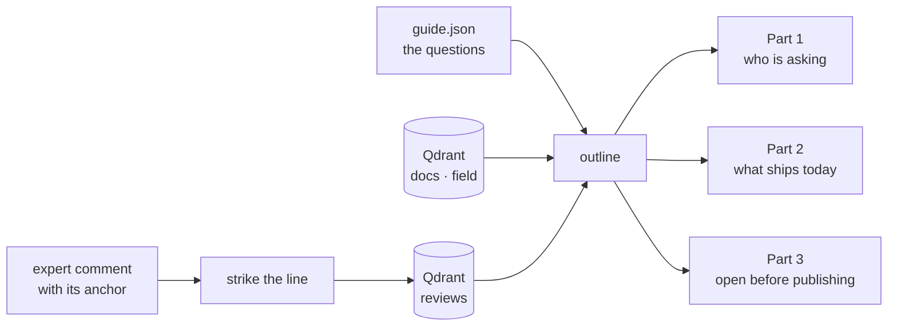

# field-guides

**A deal-backed guide outline that separates what ships today from what is still open, and keeps an expert's objection attached to the sentence it was about.**

A guide that overclaims costs more trust than a guide with a section missing. This kit builds an
outline in three parts from your sources, takes an expert's comments as they are, and keeps the
outline internal until nothing is open.

Built on [field-kit](https://github.com/meinsta/field-kit). Reads the collection that
[grounding-layer](https://github.com/meinsta/grounding-layer) keeps current.

## Get started

```bash
git clone https://github.com/meinsta/field-guides && cd field-guides
pip install -r requirements.txt
python3 test_offline.py                          # no cluster, no keys

export QDRANT_URL=... QDRANT_API_KEY=...         # the cluster grounding-layer refreshed
python3 -m fieldguide.outline                    # guide.json -> out/<id>.md
python3 -m fieldguide.review                     # review.json -> strikes, then a rebuild
```

## The three parts



| Part | Holds | Rule |
|---|---|---|
| 1. Who is asking | The field note closest to each question, by segment and vertical | Customers are never named |
| 2. What ships today | One docs sentence per question, with the id of its row | Nothing is here without a row behind it |
| 3. Open before publishing | Questions the docs do not answer, and every sentence an expert struck | The outline is internal until this is empty |

## Expert review

The expert is asked for nothing structured. A comment carries its anchor, the words they selected:

```json
{"anchor": "never leaves the region",
 "comment": "True for route and driver data. Do backups stay in the region too? Confirm with the platform team before we publish this."}
```

The line holding those words is struck and stored in Qdrant with the comment. An anchor that matches
no line, or more than one, is reported for a person to place. The strike belongs to the sentence,
so it follows that sentence into every other guide that would have used it.

## What we found

Run on a Qdrant Cloud cluster over the Quillfeather fixtures, with the guide and review shipped here:

| Step | Result |
|---|---|
| First build | 3 questions with a docs line in Part 2; 1 open (customer-managed keys, declared open in `guide.json`) |
| Review | 1 comment placed on 1 line; 0 unplaced |
| Rebuild | The struck sentence moved to Part 3 with the reviewer's question; 2 open items; status stays internal |

Part 1 has no relevance floor. Every question gets its nearest field note, and for "Can we bring our
own encryption keys?" the nearest note is about read-only keys, which is a different ask. Read
Part 1 as leads to check, since only Part 2 carries a rule about what may appear.

## Not here yet

Drafting the guide from the outline, and the whitepaper and landing-page cuts.

## Make it yours

Write your questions in [`guide.json`](guide.json). Mark a question `"open"` with the reason when
you already know the docs do not cover it. Export your reviewer's comments as anchor and comment
pairs into [`review.json`](review.json).
